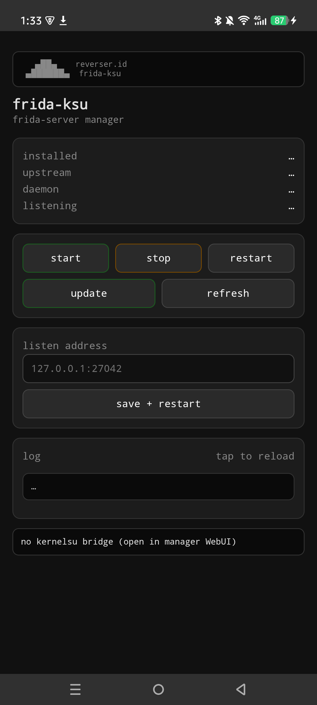

# frida-ksu — Frida server as a KernelSU module



Flashable module that runs `frida-server` as a root daemon on boot.
Installer **auto-detects the latest upstream release** (`frida/frida`
GitHub releases) for the device ABI; the **Action button** and the
**WebUI** re-check and self-update in place.

## WebUI

Status (installed / upstream / daemon / listen), start-stop-restart,
one-tap update, listen-address editor, log tail. Single self-contained
`webroot/index.html`, no CDN. Above: real render on device.

## Layout

```text
module/
  module.prop    identity (id frida-ksu, by reverser.id)
  banner.txt     reverser.id banner (installer + Action + WebUI)
  customize.sh   installer: detects latest release, downloads xz, set_perm
  lib.sh         shared helpers (arch map, version compare, dl/extract)
  service.sh     late_start boot: (re)starts daemon, pidfile+log
  action.sh      Action button: status / update check / in-place updater
  uninstall.sh   kills daemon, removes /data/adb/frida-ksu
  sepolicy.rule  ptrace + 27042 socket allows for the su domain
  listen_addr    optional override, default 127.0.0.1:27042
  webroot/       WebUI (index.html)
```

## Permissions (the careful part)

`customize.sh` applies these after extraction — the usual silent-boot-failure
cause is a non-executable binary:

| path | owner.group | mode | context |
|---|---|---|---|
| `system/bin/frida-server` | 0.0 | 0755 | `u:object_r:system_file:s0` |
| `*.sh` | 0.0 | 0755 | `u:object_r:system_file:s0` |
| everything else | 0.0 | 0644 | `u:object_r:system_file:s0` |

Runtime state lives in `/data/adb/frida-ksu/` (`frida.log`, `frida.pid`).

## Config

| file | effect |
|---|---|
| `listen_addr` | listener socket, default `127.0.0.1:27042`. `0.0.0.0:27042` exposes LAN — only on trusted networks. |
| `version` | written by installer/updater, read by status checks. |

## Build

```powershell
python tools/package.py            # -> dist/frida-ksu-<ver>.zip
python tools/package.py --check    # validate only
```

Flash the zip in KernelSU manager (NOT in custom recovery).
No reboot needed: hot-install starts the daemon immediately.

## Test

```powershell
python tools/package.py --check
sh -n module/customize.sh; sh -n module/service.sh; sh -n module/action.sh
```

`--check` validates module.prop (id regex, int versionCode, LF endings),
shell syntax, executable bits stored in the zip, and that the download URLs
for all 4 arches return HTTP 200 headers.
